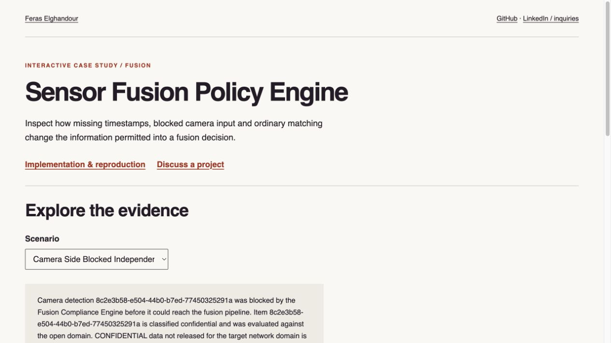
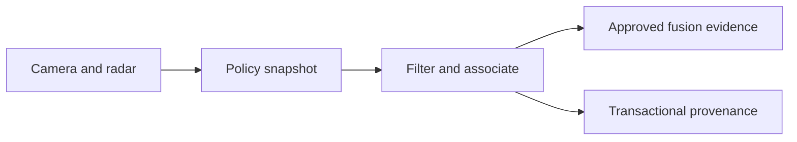

# Sensor Fusion Policy Engine

**Feras Elghandour**

Enforce data-release rules before camera and radar evidence enters a fusion pipeline.

**[Explore the interactive demonstration](https://feraselghandour.github.io/sensor-fusion-policy-engine/)** · [Operating scope](OPERATIONS.md)

[](https://feraselghandour.github.io/sensor-fusion-policy-engine/)

## Implementation

Versioned policies, per-mission snapshots, filtered persistence, SQLite transaction state, reader/admin API roles, workload limits, and inspectable provenance. Deterministic association is compared with a small learned scorer while policy enforcement remains deterministic.



## Evidence and results

206 tests passed in the release environment. A fresh evaluation covers three seeds and 3,000 synthetic missions. Mean F1 is **0.9416** for deterministic association and **0.9298** for learned association; both governed approaches record zero unauthorized field and record leakage in these cases. The learned scorer does not outperform the deterministic method.

## Run locally

Python 3.11 or later; use an isolated environment.

```sh
python -m pip install -r requirements-dev.txt
python -m pytest -q
python scripts/check_evidence.py validation/release-20261017/results.json
```

To generate a new synthetic evaluation: `python scripts/evaluate_system.py --output validation/my-run`. For the API, set distinct `FUSION_READER_TOKEN` and `FUSION_ADMIN_TOKEN` secrets of at least 32 characters, then run `python -m uvicorn api.main:app --host 127.0.0.1 --port 8000`. The optional Streamlit dashboard is described in `docs/SETUP.md`.

## Scope and limitations

Synthetic prototype. These results establish behavior on generated cases, not operational sensor accuracy, regulatory certification, or multi-host availability. Caller-supplied authorization markers are not verified human identity. Latency measurements are in-process probes. The optional dashboard has not received fresh visual verification.

[Validation record](VALIDATION.md) · [Inputs and applicable notices](DATA.md)

## Rebuild the public demonstration

Run `python demo/generate.py` to execute the synthetic scenarios through the actual implementation, then `python build_report.py`. The hosted page is a static evidence explorer; the Python application and full experiments run separately.
